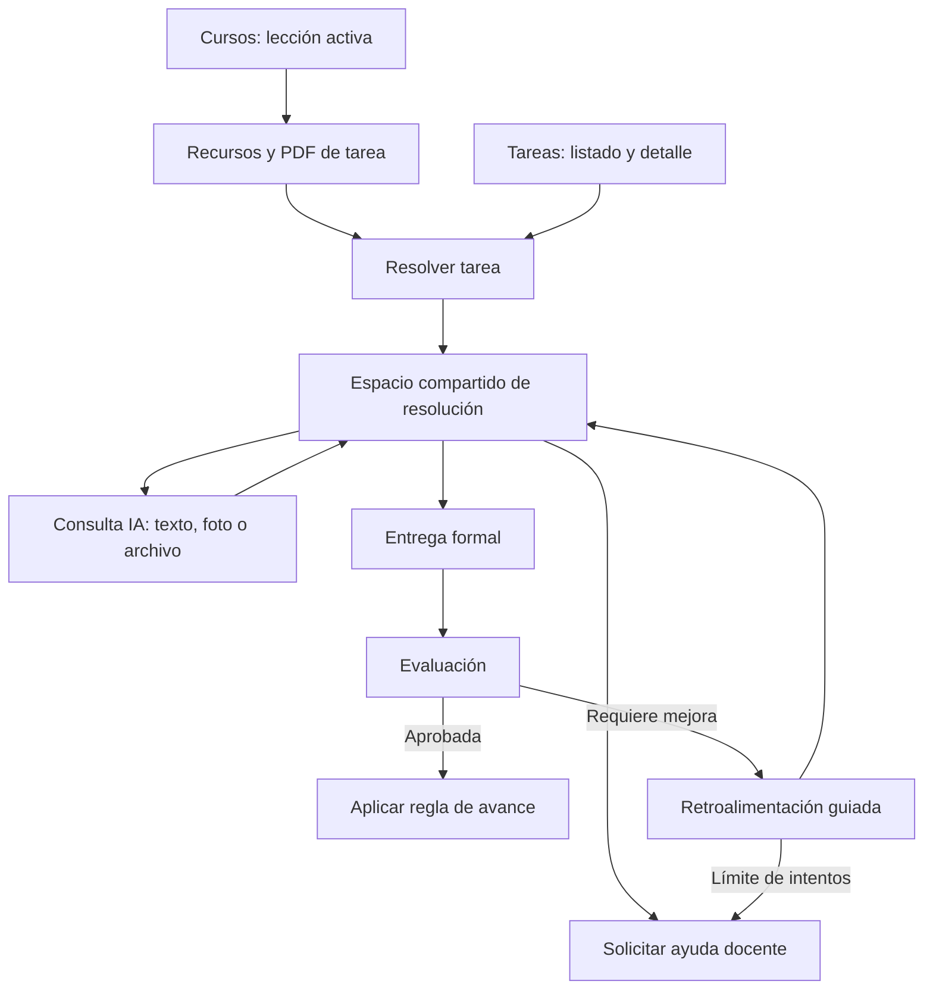

# EdTech Academy OS — Refinamiento UX/UI del rol estudiante

> Especificación recibida el 2026-11-26 (`EdTech_Student_UX_UI_Claude.zip`). Las capturas de
> referencia venían en el zip y no se versionan. Estado de implementación y discrepancias en
> [HANDOFF.md](HANDOFF.md) (entrada 2026-11-26) y [PENDIENTES.md](PENDIENTES.md).

**Destinatario:** Claude, agente de arquitectura y desarrollo del proyecto.  
**Fecha de consolidación:** 26 de noviembre de 2026.  
**Objetivo:** implementar los últimos retoques de la experiencia del estudiante en la aplicación para tablet, preservando el diseño existente.  
**Estado:** especificación funcional y visual acordada; implementación aún no verificada. Las decisiones abiertas se enumeran al final.

## 1. Instrucción principal para Claude

Trabaja sobre el repositorio existente, no crees una aplicación paralela ni reemplaces el diseño global. Inspecciona primero la estructura, navegación, componentes, estilos, estado y contratos de datos reales. Identifica qué se puede reutilizar. Este documento es una especificación de cambios, no una autorización para reescribir el backend o instalar dependencias indiscriminadamente.

La aplicación estudiante se ha planteado con React Native / Expo y pnpm; verifica el stack real antes de editar. No asumas rutas, nombres de componentes o endpoints que no hayas encontrado. Respeta las convenciones y tokens del repositorio. Si falta una integración, utiliza el patrón de datos de desarrollo existente, separando claramente los mocks de los datos reales. No simules una evaluación real de IA ni persistas información ficticia como si fuera definitiva.

Ejecuta los cambios por módulo, mantén un diff acotado y verifica el resultado en la tablet/emulador. El objetivo es refinar los componentes existentes y crear Progreso, no reinterpretar toda la aplicación. Prioriza la experiencia horizontal de la tablet objetivo (referencia previa: Lenovo 8.7 pulgadas, 4 GB RAM); confirma dimensiones lógicas reales, no confundas píxeles físicos con unidades de layout.

## 2. Sistema visual y restricciones transversales

- Mantener el lenguaje visual de las capturas: superficies claras, azul intenso con degradados, esquinas redondeadas, ilustraciones tridimensionales por asignatura, sombras suaves, iconografía amigable y acentos semánticos naranja/verde/rojo.
- Reutilizar assets existentes, tipografías, espaciados, radios y componentes. No introducir un sistema visual distinto, ni glassmorphism, ni una biblioteca UI adicional sin justificarla.
- Mantener legibilidad, contraste, estados seleccionados visibles, áreas táctiles cómodas y etiquetas accesibles. No depender exclusivamente del color para comunicar un estado.
- Respetar las barras del sistema, safe areas y orientación horizontal. El calendario tiene una exigencia explícita de un solo viewport; no extender esa restricción automáticamente a todas las pantallas.
- Usar layouts flexibles y scroll interno donde corresponda. No reducir las fuentes a tamaños ilegibles para hacer encajar contenido. Probar textos largos, listas vacías, carga, error y cantidades grandes de contenido.
- Preservar funcionalidades ajenas a los cambios solicitados. No modificar otros roles ni flujos administrativos.
- Las cifras, nombres, fechas, ilustraciones esquemáticas y notas de los ejemplos son ilustrativos. No codificarlos como datos de producción.

## 3. Sidebar — congelada visualmente

**Decisión aprobada: sin cambios.** Mantener degradado, logo, nombre José Pisconte y subtítulo según el contexto actual, iconos, tipografía, estado activo, elementos matemáticos decorativos, perfil inferior, dimensiones, márgenes y radios. Las opciones siguen siendo Inicio, Cursos, Tareas, Calendario y Progreso. Conectar la opción Progreso al nuevo módulo sin alterar su presentación. No refactorizar visualmente la sidebar ni incorporarle nuevas opciones.

## 4. Inicio — dashboard

### 4.1 Distribución

Conservar el grid existente: tarjeta grande Continúa aprendiendo y Racha de estudio en la fila superior; tres tarjetas en la fila inferior. Mantener tamaño, proporciones, márgenes y estilos. Único reemplazo visual importante: Cursos matriculados → Ranking.

### 4.2 Continúa aprendiendo

El título principal debe ser el último curso activo del estudiante, no Matemática fijo. Mostrar dinámicamente curso general, tema/lección actual, ilustración asociada, tiempo restante, progreso de módulos y CTA para retomar. El CTA lleva a la lección activa permitida por las reglas de avance. Usar la actividad persistida si existe. Si aún no hay actividad, mostrar un estado inicial coherente con el catálogo (propuesta: invitación a empezar, sin inventar un último curso). Si no hay duración o progreso disponible, evitar cifras falsas.

### 4.3 Ranking compacto

Sustituir completamente el contenido de la tarjeta Cursos (matriculados, avatares y barras de materias) respetando su espacio. Mostrar posición real, ámbito y periodo cuando estén definidos. Resaltar la fila del estudiante con naranja/dorado, su nombre y una etiqueta «Tú». Mostrar hasta dos posiciones anteriores y dos posteriores; si está primero o último, no inventar filas. Mostrar un mensaje motivacional basado en datos, por ejemplo «Estás entre los 10 mejores» solo cuando sea cierto. La tarjeta debe utilizar la misma fuente de ranking que Progreso, con un ámbito claramente indicado. Propuesta de navegación: pulsar la tarjeta abre el detalle de ranking en Progreso.

```text
Ranking                         Este mes
#3 de 60          Entre los 10 mejores
01  Estudiante A
02  Estudiante B
03  Mi nombre                    Tú   ← énfasis naranja
04  Estudiante C
05  Estudiante D
```

### 4.4 Sin cambios

- Racha de estudio: conservar ilustración, porcentaje, días y calendario visual.
- Horas: conservar meta, gráfica y comparación temporal.
- Logros: conservar tarjetas superpuestas, carrusel/iconos y estética.

### 4.5 Aceptación

El dashboard conserva su grid; cambiar la última actividad actualiza la tarjeta principal; el ranking no muestra datos fijos ni posiciones inexistentes; las otras tres tarjetas mantienen su diseño.

## 5. Cursos — catálogo

### 5.1 Barra superior

Eliminar Filtros (más recientes, categoría y filtros avanzados asociados a ese botón). Mover Todos, En progreso, Completados y Favoritos a la derecha, junto a Cuadrícula/Lista. Mantener sus contadores y estilo. A la izquierda colocar un buscador de cursos.

```text
[ Buscar cursos…          ] [Todos 6][En progreso 3][Completados 2][Favoritos 1] [▦][☰]
```

La búsqueda debe combinarse con el estado seleccionado, funcionar en ambas vistas y permitir limpiar el texto. Buscar por nombre del curso; opcionalmente por área si ya existe soporte. Propuesta técnica: ignorar mayúsculas y tildes, evitar consultas innecesarias y mostrar un estado sin resultados. Mantener contadores semánticamente consistentes (definir si representan el catálogo completo o el resultado filtrado; no alternar silenciosamente). No crear una segunda barra de filtros.

### 5.2 Tarjetas y jerarquía académica

Mantener las tarjetas, ilustraciones, color por materia, favoritos, número de lecciones, duración, barra de progreso, botones Empezar/Continuar y grid de tres columnas en el viewport objetivo cuando sea viable. El título de cada tarjeta representa un curso general, no un tema concreto.

| Título actual          | Curso general de ejemplo | Tema interno           |
| ---------------------- | ------------------------ | ---------------------- |
| Ecuaciones y funciones | Álgebra                  | Ecuaciones y funciones |
| El ciclo del agua      | Ciencia                  | El ciclo del agua      |
| Sucesiones y patrones  | Razonamiento Matemático  | Sucesiones y patrones  |
| Comprensión lectora    | Comunicación             | Comprensión lectora    |
| Perú en el siglo XX    | Historia                 | Perú en el siglo XX    |
| Relieve del Perú       | Geografía                | Relieve del Perú       |

Otros cursos posibles: Geometría, Trigonometría. El catálogo definitivo depende de la academia. No hacer una sustitución masiva de nombres en producción sin validar el modelo académico. Las métricas deben representar el curso completo y no el tema que antes figuraba como curso.

Jerarquía objetivo: Área académica → Curso → Unidad → Tema → Lección → Recursos/tarea. Ejemplo: Matemática → Álgebra → Ecuaciones → Ecuaciones de primer grado → Resolución de ecuaciones. Si el modelo existente no diferencia tema y lección, identificar la brecha antes de introducir niveles de datos artificiales. La etiqueta de la ilustración puede representar el área, pero no debe duplicar el título sin aportar contexto.

### 5.3 Aceptación

Se puede buscar y combinar con los cuatro estados; cuadrícula/lista permanecen funcionales; no aparece Filtros; las tarjetas identifican cursos generales y muestran indicadores correspondientes al curso completo.

## 6. Cursos — interior y aprendizaje secuencial

### 6.1 Distribución

Conservar las dos columnas actuales y el encabezado con retroceso, ilustración, identificación de curso, unidad y lección. Mantener el reproductor, sus controles y la barra de progreso superior derecha. La columna izquierda permanece estable al alternar pestañas derechas.

```text
┌─────────────────────────────────┬──────────────────────────┐
│ ← Álgebra / lección actual       │ Progreso del curso  72%   │
│ Unidad 1 · Lección 2             │ [ Lección ] [ Recursos ] │
│                                 ├──────────────────────────┤
│       Reproductor de video       │ Temario O materiales     │
│                                 │ según pestaña activa     │
├─────────────────────────────────┤                          │
│ Resumen escrito de la lección    │                          │
└─────────────────────────────────┴──────────────────────────┘
```

Eliminar el selector inferior Recursos / Ejercicios / Notas. Sustituirlo por un resumen escrito del tema activo: explicación breve, objetivos o conceptos principales cuando estén disponibles. No ocultar ni sustituir el video al seleccionar Recursos. No añadir un chat a esta vista.

### 6.2 Pestaña Lección

Mantener el temario del panel derecho con unidades desplegables, cantidad de lecciones y progreso por unidad. Debe escalar a cursos largos como Álgebra. Diferenciar claramente completado, activo y bloqueado; usar check, play y candado respectivamente, además de texto cuando sea útil. La unidad activa debe ser fácil de localizar; conservar el estilo de selección actual. Permitir scroll interno del temario si es necesario. Expandir una unidad para inspeccionar su estructura no equivale a permitir iniciar una lección bloqueada.

**Regla de negocio aprobada:** avance secuencial estricto. No se puede adelantar ni volver a lecciones anteriores desde la navegación de aprendizaje. Solo la lección activa es accesible para estudiar. Los elementos completados muestran su estado; futuros permanecen bloqueados. No confundir retroceder de una pantalla a otra con retroceder en la secuencia académica. El estado debe mantenerse al salir y regresar. La restricción debe ser validada también por la capa de negocio/API cuando exista; no basta con deshabilitar visualmente botones.

La propuesta aprobada muestra que aprobar la tarea permite avanzar. Queda pendiente confirmar el conjunto exacto de condiciones (video, tarea, ejercicios, nota mínima u otros criterios). No inventar esas reglas. Centralizar la decisión de desbloqueo y conservar las reglas existentes hasta que el responsable académico confirme cualquier cambio. Considerar la lección final y cursos sin tarea como casos que requieren reglas explícitas.

### 6.3 Pestaña Recursos

Renombrar Asistente IA a Recursos. Mantener solamente Lección y Recursos como pestañas principales. El panel derecho mostrará dos secciones, sin introducir otra barra de pestañas:

**Material de estudio:** PDFs de ejemplos resueltos, ejercicios de práctica generados con IA, otros materiales complementarios de la lección activa. Mostrar título, tipo y acción para abrir/descargar según capacidades reales del dispositivo.

**Tu tarea:** reutilizar tarjeta actual con título, estado, intentos, fecha límite cuando corresponda, PDF de tarea y CTA «Resolver tarea». El CTA abre una pantalla independiente; no implica envío ni consume intento. No mostrar materiales de otra lección. Los materiales generados con IA deben llegar por un mecanismo existente o por un contrato pendiente; no confundir un mock con generación operativa.

### 6.4 Aceptación

Alternar Lección/Recursos conserva video y resumen; el selector inferior desaparece; temario escalable; navegación secuencial aplicada; documentos asociados al contexto correcto; Resolver tarea abre el espacio compartido sin entregar automáticamente.

## 7. Espacio compartido de resolución de tareas

**Propuesta aprobada expresamente.** Reutilizar la antigua vista Asistente IA como pantalla independiente, accesible desde Cursos → Recursos → Resolver tarea y desde Tareas → seleccionar tarea → Resolver tarea. Un único componente, contexto e historial por tarea; no duplicar interfaces ni lógica. Mantener el contexto al regresar a la pantalla de origen.



### 7.1 Layout

Encabezado: botón volver, curso, unidad/lección, título de tarea, estado. Dos columnas, reutilizando el diseño de la captura 06.

- Izquierda: chat con selector Asistente IA / Docente. Historial, mensajes, adjuntos, campo de texto, cámara, archivos y enviar. Permitir fotografiar el desarrollo en papel, previsualizar el adjunto y eliminarlo antes de enviarlo. Mantener historial separado por tarea y estudiante. El chat docente debe mostrar su estado real de disponibilidad/solicitud; no simular respuestas humanas.
- Derecha: tarjeta Tu tarea con PDF, instrucciones, fecha, estado, intentos y botón Entregar tarea. Debajo mantener la tarjeta verde ¿Necesitas a tu docente? y CTA Pedir ayuda al docente.
- El CTA de ayuda debe integrarse con el chat docente y, cuando corresponda, el flujo de videollamada mediante enlace facilitado por el docente (Google Meet previsto en el proyecto). No lanzar una llamada automáticamente ni inventar un enlace.
- Mantener chat y detalle con scroll apropiado, campo de entrada accesible con teclado abierto y cámara/archivos gestionados con permisos reales. No perder el borrador al cambiar de pestaña accidentalmente.

### 7.2 Consulta vs entrega

| Acción                           | Resultado                                                                           |
| -------------------------------- | ----------------------------------------------------------------------------------- |
| Resolver tarea                   | Abre el espacio, no consume intento                                                 |
| Enviar texto/foto/PDF al chat IA | Consulta y orientación, no consume intento                                          |
| Entregar tarea                   | Envío formal de evidencia para evaluación; contabiliza intento según regla aprobada |
| Pedir ayuda docente              | Solicitud humana contextualizada, no equivale a entrega                             |

La IA debe conocer el contexto de la lección, tarea e intentos autorizados y orientar con pistas, explicar errores y ayudar a mejorar el procedimiento sin entregar directamente todas las respuestas. La evaluación formal no debe confundirse con un mensaje del chat. Evitar duplicar envíos por toques repetidos; no contabilizar como intento una carga fallida. Mostrar estado de procesamiento, confirmación real y errores recuperables. La evaluación, nota y desbloqueo deben depender de la fuente de verdad del sistema.

Mantener contador de tres intentos según el flujo mostrado y el planteamiento previo del proyecto. Al agotar el límite, escalar a tutor/docente real en lugar de permitir intentos ilimitados o desbloquear artificialmente. La modalidad exacta de evaluación y reapertura requiere contrato académico. El docente debe recibir solo el contexto pertinente y autorizado. No modificar ni exponer información de otros estudiantes.

### 7.3 Aceptación

Ambos accesos abren la misma tarea; consultar no consume intento; entrega explícita diferenciada; adjuntos y errores gestionados; ayuda docente visible; historial y estado se mantienen coherentes entre Cursos y Tareas; no hay chat en la vista de reproducción de lección.

## 8. Tareas — listado principal

### 8.1 Simplificar navegación (aprobado)

Conservar cuatro tarjetas superiores Pendientes, Para hoy, Entregadas y Promedio con ilustraciones, estilos y dimensiones. Convertirlas en controles seleccionables con estado activo perceptible. Eliminar la barra secundaria completa (Pendientes, Entregadas, Calificadas, Vencidas) y el botón Filtros. No añadir otro selector redundante.

| Tarjeta                     | Contenido de la columna izquierda                                     | Detalle derecho                                        |
| --------------------------- | --------------------------------------------------------------------- | ------------------------------------------------------ |
| Pendientes (predeterminada) | Por resolver; urgentes primero; vencidas aún resolubles identificadas | Instrucciones, material, plazo, estado, Resolver tarea |
| Para hoy                    | Pendientes cuya fecha de entrega vence hoy                            | Igual al anterior                                      |
| Entregadas                  | Entregas recientes, evaluadas o pendientes de calificar               | Estado, nota si existe, detalle de entrega             |
| Promedio                    | Historial de tareas calificadas, nota junto a cada fila               | Resultado y detalle de evaluación                      |

### 8.2 Layout y selección

Conservar el master-detail existente (listado izquierdo y panel derecho). Mantener agrupación Hoy / Esta semana / Más adelante para pendientes, ilustraciones por curso, fechas, puntuación, tipo de actividad, instrucciones y PDFs. Al cambiar tarjeta, actualizar ambos paneles y seleccionar una tarea válida (primera si existe); no dejar detalle de un elemento de otro filtro. Al seleccionar una fila, actualizar su detalle sin abrir una pantalla adicional. En histórico ordenar por entrega reciente, mostrando notas junto a cada elemento y «Por calificar» donde corresponda. Promedio no debe tratar notas pendientes como cero. Las fechas límite deben interpretarse con la zona horaria de la academia.

El botón Resolver tarea lleva al componente compartido de la sección 7. En entregadas/calificadas, mostrar detalle de entrega sin habilitar una nueva resolución no autorizada. Conservar posibilidad de reintentar solo si el flujo académico lo permite. Estado vacío claro para cada vista.

```text
[ Pendientes 4 ] [ Para hoy 1 ] [ Entregadas 3 ] [ Promedio 17 ]
┌────────────────────────────┬───────────────────────────────┐
│ HOY                        │ Ilustración / curso           │
│ Funciones cuadráticas      │ Funciones cuadráticas         │
│ ESTA SEMANA                │ Fecha / puntos / tipo         │
│ Informe: ciclo del agua    │ Instrucciones                 │
│ Lectura: capítulo 3        │ PDF de tarea                  │
│ MÁS ADELANTE               │ [ Resolver tarea ]            │
└────────────────────────────┴───────────────────────────────┘
```

### 8.3 Aceptación

Sin barra ni filtros redundantes; Pendientes seleccionado al entrar; cuatro tarjetas cambian listado y detalle; notas visibles en vistas pertinentes; diseño de dos columnas preservado; navegación coherente con el espacio de resolución compartido.

## 9. Calendario — un solo viewport

**Cambio mínimo aprobado:** eliminar totalmente Próximos eventos, incluyendo su encabezado, Ver todos y lista. Mantener tarjetas superiores Tareas próximas, Clases y Solicitudes de ayuda, calendario izquierdo con navegación de fechas, leyenda de Clase / Entrega / Asesoría o Ayuda, panel derecho, selectores Diaria / Semanal / Mensual, navegación y eventos.

La eliminación debe ir acompañada de redistribución del espacio. No dejar un hueco debajo de la leyenda ni un panel derecho artificialmente alto. Ampliar proporcionalmente el calendario izquierdo (distribuir sus filas de forma equilibrada); compactar moderadamente el selector de vistas y sus márgenes si hace falta. Los extremos superiores e inferiores de ambas columnas deben alinearse. No estirar artificialmente cada evento para llenar espacio cuando existan pocos.

```text
┌──────────────────┬─────────────────┬─────────────────────┐
│ Tareas próximas  │ Clases          │ Solicitudes de ayuda│
└──────────────────┴─────────────────┴─────────────────────┘
┌─────────────────────┬────────────────────────────────────┐
│ Mes / navegación    │ [Diaria] [Semanal] [Mensual]        │
│ L M M J V S D       │ Fecha seleccionada          < >    │
│ Calendario          │ 08:00 Clase                        │
│ (filas distribuidas │ 09:30 Clase                        │
│  proporcionalmente)│ 11:00 Entrega                      │
│                     │ 14:00 Asesoría                     │
├─────────────────────┤ 16:00 Clase                        │
│ Leyenda             │                                    │
└─────────────────────┴────────────────────────────────────┘
                       ↑ bordes inferiores alineados
```

### 9.1 Implementación y aceptación

Usar altura disponible del contenedor raíz después de safe areas y barras del sistema; fila de métricas con altura natural y área principal flexible. En React Native, verificar la cadena de contenedores flexibles y evitar ScrollView global en esta pantalla. Permitir desplazamiento interno de agenda si hay más eventos de los que caben; la vista semanal/mensual también debe contener su contenido dentro del área disponible. No usar alturas absolutas basadas en la captura ni recortar controles para forzar el ajuste. Verificar viewport real de tablet horizontal, meses de seis semanas, días sin eventos y días con muchos eventos. No debe existir scroll vertical global ni gap residual bajo leyenda; conservar todos los controles y legibilidad.

## 10. Progreso — módulo nuevo

**Propuesta conceptual aprobada.** Crear una experiencia motivacional, amigable, visual, no un reporte administrativo. Tres pilares: mi avance, mi rendimiento y mi posición. Reutilizar tarjetas, gradientes, ilustraciones 3D por curso, barras e iconos de la aplicación. No duplicar carrusel de Logros ni calendario de racha de Inicio.

### 10.1 Layout propuesto

```text
┌─────────────────────────────────────┬──────────────────────┐
│ TU PROGRESO ACADÉMICO               │ MI POSICIÓN           │
│ ¡Vas por buen camino!         68%   │ #3 de 60              │
│ [█████████████░░░░]      ilustración│ ↑ 2 posiciones       │
│ Cada lección te acerca a tu meta    │ Ver tarjeta académica│
├───────────────────┬─────────────────┴───┬──────────────────┤
│ Promedio 17.5/20  │ Lecciones 42/62     │ Tareas 18/21      │
├─────────────────────────────────────┬──────────────────────┤
│ MI RENDIMIENTO POR CURSO            │ RANKING ACADEMIA      │
│ Álgebra       ███████░ 72%    18/20 │ #1 Estudiante A       │
│ Geometría     ██████░░ 65%    16/20 │ #2 Estudiante B       │
│ Comunicación ████████ 85%    19/20 │ #3 Tú (naranja)       │
│ Ciencia       █████░░░ 50%    17/20 │ #4 Estudiante C       │
│                                     │ #5 Estudiante D       │
│                                     │ Ver ranking completo │
├─────────────────────────────────────┴──────────────────────┤
│ MI EVOLUCIÓN ACADÉMICA                                     │
│ Gráfica de notas a lo largo del tiempo                      │
└────────────────────────────────────────────────────────────┘
```

Este esquema reproduce la propuesta aprobada en conversación; no es una captura implementada. Permitir scroll vertical natural en Progreso si el contenido excede el viewport (la restricción de pantalla única corresponde a Calendario). Mantener jerarquía de lectura, sin obligar a que todos los datos aparezcan a la vez.

### 10.2 Componentes

1. **Hero progreso académico:** tarjeta azul degradada, porcentaje destacado, barra y una ilustración de avance (escalones/barras crecientes y flecha ascendente, con detalles dorados). Texto motivacional contextual; evitar afirmaciones falsas. Porcentaje derivado de avance real, no de promedio de notas.
2. **Mi posición:** tarjeta con trofeo y acento naranja/dorado, posición real y total de participantes, periodo, variación respecto a periodo anterior si existe, CTA Ver mi tarjeta académica. Si no hay ranking calculable, mostrar estado sin posición, no #0 ni #1 ficticio.
3. **Tres métricas:** promedio general sobre 20, lecciones completadas/total, tareas aprobadas/evaluadas. Usar denominadores claros y un estado sin datos; excluir tareas aún no evaluadas del promedio.
4. **Rendimiento por curso:** filas con icono y color existente, nombre, avance porcentual y promedio sobre 20 a la derecha. Mostrar todos los cursos del estudiante mediante lista adaptable. Avance y rendimiento son conceptos diferentes, no confundirlos. Ejemplo: Álgebra 72% y 18/20, Geometría 65% y 16/20. Sin nota: «Sin calificar».
5. **Ranking detallado:** posición y nombres visibles según política de privacidad, resaltar estudiante con naranja/dorado y «Tú», mostrar vecinos inmediatos y CTA Ver clasificación completa. La vista completa puede implementarse como modal o pantalla según navegación existente; permitir listas grandes sin renderizar todo a la vez. Si se muestra una puntuación, identificar la métrica real y no exponer notas individuales de terceros sin autorización. Usar el mismo servicio/datos que Inicio; especificar ámbito y periodo.
6. **Evolución académica:** gráfica de línea con calificaciones promedio por periodo (propuesta semanal), escala 0–20, etiquetas legibles. No interpolar periodos sin datos como cero ni fingir una tendencia. Mostrar datos insuficientes cuando corresponda. Mantener el estilo gráfico de Horas en Inicio.
7. **Retroalimentación motivacional:** mensajes constructivos basados en datos, p. ej. «Has mejorado en Álgebra» solo si existe evidencia; evitar comparaciones humillantes, alertas excesivas o mensajes que reduzcan al estudiante a una posición. No añadir otro panel grande si puede resolverse dentro de las tarjetas.

### 10.3 Tarjeta académica personalizada

Abrir mediante CTA en Mi posición, preferentemente modal que no abandone Progreso. Inspiración: tarjeta de jugador o reconocimiento académico, pero con identidad de la academia, sin introducir estética ajena. Diseño vertical, fondo azul oscuro degradado, detalles dorados, logo/nombre de academia, trofeo o medalla central, nombre del estudiante, posición y total, periodo, promedio, avance y racha. La posición y métricas se actualizan con datos reales. No utilizar «Estudiante destacado» si no corresponde a un criterio aprobado; adaptar textos a cualquier posición y a estados sin ranking.

```text
┌──────────────────────────────┐
│ Logo · José Pisconte         │
│ Reforzamiento Académico      │
│                              │
│            TROFEO            │
│            #03               │
│     Mi posición académica    │
│      De 60 estudiantes       │
│                              │
│ Nombre del estudiante        │
│ 17.5/20   68%     12 días    │
│ Promedio  Avance  Racha      │
│ Periodo: mes/año             │
└──────────────────────────────┘
```

La generación se entiende como composición visual dinámica dentro de la app. Exportar o compartir como imagen es opcional y aún no aprobado para el MVP. No añadir dependencias de captura/exportación sin confirmación. Si en el futuro se habilita compartir, evaluar privacidad del estudiante y consentimiento.

### 10.4 Aceptación

Progreso accesible desde la sidebar intacta; apariencia coherente con Inicio; avance general y por curso, notas, ranking, evolución y tarjeta visual funcionales; ausencia de datos se maneja correctamente; ranking consistente con Inicio; los números son reales o mocks explícitamente identificados en desarrollo; no se penaliza visualmente a estudiantes de menor rendimiento.

## 11. Contratos funcionales y consistencia de datos

No se han inspeccionado repositorio ni API. Esta sección propone conceptos, no impone nombres de tablas/endpoints ni cambios de esquema. Claude debe mapearlos a los contratos reales.

| Concepto                 | Datos mínimos que necesita la UI                                                                                    |
| ------------------------ | ------------------------------------------------------------------------------------------------------------------- |
| Curso                    | Identidad, área, nombre general, ilustración, matrícula, favorito, progreso, duración, conteo de lecciones          |
| Actividad de aprendizaje | Curso/unidad/tema/lección activa, última actividad, posición de reproducción si disponible, estado secuencial       |
| Lección                  | Identidad, título, video, resumen, orden, recursos, estado, tarea asociada cuando exista                            |
| Recurso                  | Identidad, título, tipo, archivo/URL autorizada, lección asociada                                                   |
| Tarea                    | Identidad, curso/lección, instrucciones, archivo, fecha límite, estado, intentos, puntuación máxima                 |
| Entrega                  | Identidad, tarea, evidencia, fecha, estado de evaluación, nota y retroalimentación                                  |
| Conversación             | Estudiante/tarea, canal IA o docente, historial, adjuntos, estado de solicitud                                      |
| Evento                   | Tipo, título, fecha/hora, duración, referencia a clase, tarea o asesoría                                            |
| Progreso                 | Avance general y por curso, métricas agregadas, promedio, serie temporal                                            |
| Ranking                  | Ámbito, periodo, posición, total, métrica de clasificación, participantes visibles autorizados, variación si existe |

Mantener una sola fuente de verdad para cada entidad. No calcular rankings contradictorios en Inicio y Progreso. No duplicar tarea/historial al acceder desde distintas pantallas. Actualizar estados relacionados después de una entrega, evaluación o avance. Definir un tratamiento explícito de carga, error y ausencia de datos; nunca sustituir valores desconocidos por cero sin justificación.

## 12. Decisiones abiertas: no bloquear el retoque visual, no inventar reglas

| Tema                | Decisión pendiente                                                 | Propuesta inicial, no definitiva                                                    |
| ------------------- | ------------------------------------------------------------------ | ----------------------------------------------------------------------------------- |
| Ranking             | Fórmula, desempates y elegibilidad                                 | Puntos que combinen notas, tareas y constancia; no implementar pesos sin aprobación |
| Ranking             | Ámbito                                                             | Academia, salón/grupo o ambos; indicar alcance en cada tarjeta                      |
| Ranking             | Periodo y actualización                                            | Mensual e histórico como posibles vistas                                            |
| Promedio y progreso | Ponderaciones, denominadores, cursos sin evaluación                | Mostrar únicamente métricas calculadas con reglas del sistema                       |
| Desbloqueo          | Condición exacta, nota mínima y lecciones sin tarea                | Avance tras aprobación según reglas académicas existentes                           |
| Intentos            | Reapertura y escalamiento docente                                  | Tres intentos y ayuda humana cuando se agoten; validar contrato                     |
| Catálogo            | Temario y clasificación definitivos                                | Ejemplos del documento como guía, no temario oficial                                |
| Tarjeta académica   | Exportación/compartir                                              | Solo visual para MVP salvo aprobación posterior                                     |
| IA y docente        | Integraciones reales, evaluación, generación de PDF y videollamada | Reutilizar servicios disponibles; declarar los faltantes                            |

Si existen reglas implementadas, preservarlas salvo conflicto explícito con requisitos aprobados y reportar discrepancias. Si no existen, aislar el contrato e implementar únicamente UI con mocks claramente identificados mientras se valida la lógica.

## 13. Plan de ejecución recomendado

1. Inspeccionar repositorio, rutas, navegación, componentes, estilos, fuentes de datos y scripts. Identificar pantallas y dependencias reales. Registrar estado inicial de git y evitar sobrescribir cambios del usuario.
2. Inicio: último curso y ranking compacto. Verificar que Racha, Horas y Logros permanecen intactos.
3. Cursos catálogo: barra de búsqueda, estados, vistas, jerarquía general y datos.
4. Interior de curso: resumen, dos pestañas, temario, recursos y navegación secuencial.
5. Extraer/reutilizar espacio de resolución de tareas; integrar ambas rutas de acceso y acciones de IA/docente.
6. Tareas: tarjetas superiores interactivas y master-detail dinámico; eliminar controles secundarios.
7. Calendario: retirar próximos eventos y optimizar viewport.
8. Progreso: crear pantalla, tarjetas, ranking y tarjeta académica; conectar sidebar sin alterar visual.
9. Pruebas cruzadas, accesibilidad, rendimiento y revisión visual contra capturas. Ejecutar scripts existentes de lint, typecheck y tests cuando estén disponibles; no asumir nombres de comandos. Revisar cambios de layout en dispositivo real/emulador.

## 14. Checklist de entrega a revisar con el responsable del proyecto

- [ ] Sidebar visualmente intacta; rutas existentes no rotas.
- [ ] Inicio muestra último curso activo y ranking compacto; demás tarjetas conservadas.
- [ ] Cursos: buscador a la izquierda, estados y vistas a la derecha, sin Filtros.
- [ ] Cursos generales correctamente diferenciados de temas; métricas coherentes.
- [ ] Video y resumen permanecen al alternar Lección/Recursos.
- [ ] Temario escalable; lecciones previas/futuras no navegables según regla aprobada.
- [ ] PDFs y tarea corresponden a la lección activa.
- [ ] Mismo espacio de resolución desde Cursos y Tareas; consulta no consume intento.
- [ ] Entrega formal, contador, feedback, adjuntos y asistencia docente claramente diferenciados.
- [ ] Tareas: cuatro tarjetas controlan listado y detalle; sin filtros secundarios; notas visibles cuando corresponde.
- [ ] Calendario: sin Próximos eventos ni scroll global; columnas alineadas y sin gap residual; agenda con scroll interno si es necesario.
- [ ] Progreso nuevo con hero, posición, métricas, rendimiento por curso, ranking, evolución y tarjeta académica.
- [ ] Estados vacíos/carga/error, textos largos, listas extensas, teclado y safe areas probados.
- [ ] No se añadieron dependencias, mocks persistentes o cambios ajenos sin justificar.
- [ ] Reglas pendientes identificadas; ninguna fórmula o política académica inventada.
- [ ] Reportar archivos modificados, componentes reutilizados, comandos de validación y resultados reales, limitaciones, integraciones pendientes y capturas finales si están disponibles.

## 15. Referencias visuales incluidas

Las nueve imágenes de `referencias/` son capturas originales compartidas durante la revisión del estudiante. Se eliminaron duplicados exactos del paquete. No son mockups de la nueva interfaz; los esquemas de este MD describen los cambios acordados. Progreso no tenía captura existente porque aún no estaba desarrollado.

**Instrucción final:** utiliza las capturas como referencia de fidelidad visual y este documento como fuente de requisitos. No copies los valores ficticios de las capturas. No sustituyas todo el diseño por los wireframes: son esquemas de organización, no una nueva biblioteca de componentes. Entrega un resultado coherente con la app existente y deja visibles las decisiones que requieren confirmación.
